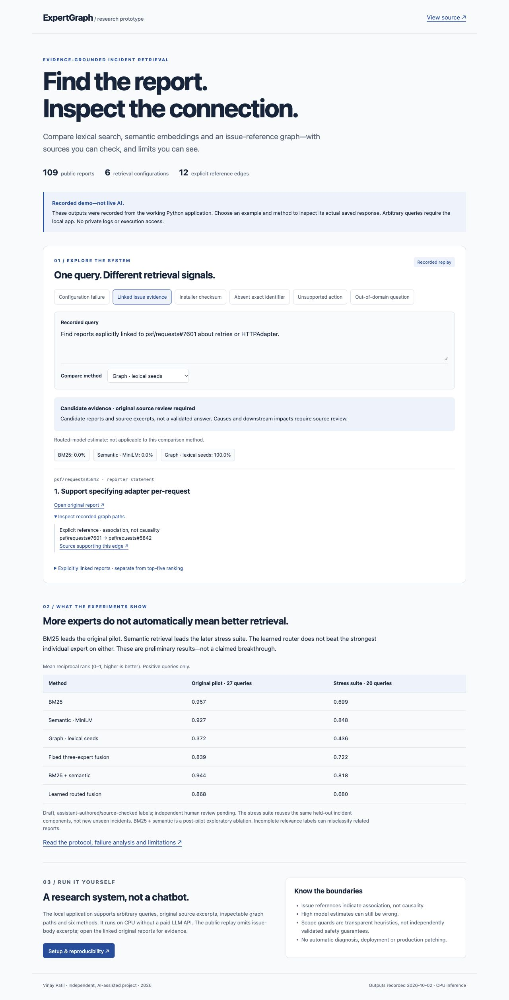

# ExpertGraph

### Evidence-grounded multi-expert retrieval for software incident reports

[](https://github.com/Vinay-113/expertgraph/actions/workflows/tests.yml)
[](LICENSE)

[**Explore the recorded demo →**](https://vinay-113.github.io/expertgraph/)
 · [Project brief](docs/PROJECT_BRIEF.md)
 · [Methods](docs/METHODS.md)
 · [Results & failure analysis](artifacts/validation-v1/REPORT.md)

> The public page replays **36 real responses** across six examples and six
> methods. It is **not live inference** and cannot accept arbitrary queries.
> The full Python app runs locally. Independent human benchmark review is pending.



An evidence-preserving retrieval system for software incident reports. It combines exact-match search (BM25), pretrained sentence embeddings, and traversal through **explicit issue references**. An interpretable learned router combines the experts for each query.

## Research question

Does query-dependent expert routing improve evidence retrieval over individual experts and fixed fusion on public software incident reports?

This repository is a research prototype. Its graph represents documented references and shared entities, **not verified causal relationships**. Retrieved reports offer investigative context; they do not establish a root cause. Semantic similarity and retrieval scores are not probabilities.

## Experiment

Six configurations: BM25, semantic, graph, fixed reciprocal-rank fusion, routed reciprocal-rank fusion, and a post-pilot BM25+semantic ablation. A single-expert baseline is selected on development data. Corpus and benchmark snapshots are hashed. Training and development supervision are separated from test labels by explicit-reference incident components. Development data is reused for router selection and relevance calibration, which limits their independence.

The primary metrics are recall@5, MRR, nDCG@5, and median retrieval latency. Evidence coverage can be measured against explicitly labelled supporting incident IDs. Extractive reports cite the source text; generative-answer correctness is not claimed without a separately annotated answer evaluation.

## Status and measured results

The local prototype, collector, trained router, evaluator and browser explorer work. The corpus contains 109 public issue reports from actions/setup-python, pytest-dev/pytest and psf/requests, with 12 explicit reference edges. Component splits contain 55 training, 27 development and 27 test documents.

The pilot includes 27 source-checked positive questions and six obvious out-of-domain negatives. Independent human annotation is pending. Title-derived train/development questions provide weak supervision, not human gold. The router is selected on development data, not test results.

Pilot MRR: BM25 0.957; semantic 0.927; graph 0.372; fixed hybrid 0.839; routed hybrid 0.868. Routed recall@5 is 0.944. Routing improves on fixed fusion here, but **does not outperform BM25**. These are small-pilot observations, not production accuracy or established generalization.

Canonical measurements: [results.json](artifacts/results/results.json), [per-query results](artifacts/results/per_query.json), [research report](artifacts/results/REPORT.md), [comparison plot](artifacts/results/retrieval_comparison.png).

## Run the existing installation

From this project directory:

```bash
.venv/bin/python run_expertgraph.py serve --port 8765
.venv/bin/python run_expertgraph.py query 'pytest config file extension causes FileNotFoundError'
.venv/bin/python -m pytest -q
.venv/bin/python run_expertgraph.py validate
```

Open http://127.0.0.1:8765. The server binds loopback only. Do not start a second copy if the demo is already running. Model and document embeddings are cached; inference is local. No paid LLM API is required and no generative chatbot is implemented.

The source-tree launcher avoids editable-install .pth startup failures when macOS marks that file hidden. The method dropdown compares BM25, semantic, graph, equal-weight fusion, learned routing and a BM25+semantic ablation. The routed calibrator is not applied to other methods. The estimate is unvalidated and is deliberately not displayed as a correctness percentage.

## Next-stage validation

`validate` leaves the original pilot, fitted model and original annotation worksheet unchanged. See [diagnostic report](artifacts/validation-v1/REPORT.md), [source review](artifacts/validation-v1/SOURCE_REVIEW.md) and [independent-review worksheet](artifacts/validation-v1/annotation_review.csv).

The 36-query diagnostic suite has 20 positives and 16 negatives on the same test incident components; it is not independent gold or unseen-incident evaluation. Frozen-model MRR is 0.848 for semantic retrieval, 0.818 for BM25+semantic, 0.722 for fixed three-expert fusion, 0.699 for BM25 and 0.680 for learned routing. The different ordering from the original pilot is a finding, not proof that one method generalizes best.

Two negative requests were accepted by the raw routed model. Transparent rules now abstain on absent exact identifiers, explicit unavailable private/live context and unsupported execution requests. Both accepted negatives are blocked on this same regression suite; this is not independent validation of the rules. Raw model estimates and the 0.8 threshold are unchanged. Unknown wording can still bypass these heuristics, and negative/relevance labels need human review.

The initial stress outcomes are retained in results.raw.json/per_query.raw.json. Exploratory component-bootstrap intervals and per-query outcomes are included. The browser exposes original and stress results separately. No retraining or post-test threshold tuning was performed.

## Run the full local app

Tested on Python 3.11.15, macOS arm64:

```bash
git clone https://github.com/Vinay-113/expertgraph.git
cd expertgraph
python3.11 -m venv .venv
.venv/bin/python -m pip install -r requirements-lock.txt
.venv/bin/python -m pip install --no-deps -e .
.venv/bin/python scripts/reproduce.py --output replays/local-v1
.venv/bin/python run_expertgraph.py --root replays/local-v1 serve --port 8765
```

Open [the full local app](http://127.0.0.1:8765). This localhost link is not a
shareable public demo. The recorded public demo is linked at the top of this page.

`reproduce.py` creates a new experiment directory, restores/verifies the frozen
corpus, trains on training/development supervision, runs the pilot and then
frozen-model stress diagnostics. It never overwrites the published baseline.
Serialized model hashes and timings can differ on replay. Its output directory
must not already exist. The lock records the tested platform; other platforms
may need compatible versions via `pip install -e '.[dev]'` and must not assume
identical measurements.

The raw corpus and API cache are excluded from Git. `restore` fetches the exact incident IDs from the saved manifest and refuses a hash mismatch. Public issues can change: exact replay then needs the original local data/corpus.jsonl and data/manifest.json. Never replace a snapshot silently and quote its old metrics. Public API limits may require waiting or an optional GITHUB_TOKEN; the project never writes that token to disk. The existing local demo needs no credentials.

The embedding model revision is recorded and reused. First setup downloads MiniLM from Hugging Face. Never load untrusted routing.joblib files: deserialization is intended only for the artifact generated locally by this evaluator.

For a new experiment, use a new root without old data/results, run `collect --per-repo 40`, and author a matching held-out benchmark. `collect` refuses to overwrite frozen experiments.

## Check the code without downloading a model

```bash
python -m pip install numpy scikit-learn networkx matplotlib pytest
python -m pytest -q
python scripts/check_public_demo.py
node --check ui/app.js
node --check docs/demo/demo.js
```

The author's installation passes 29 tests and 24 local API smoke checks. The
corpus-dependent test skips in a source-only clone. CI checks source contracts
and recorded-demo integrity, **not a full model replay** or research validity.
The workflow badge shows the actual remote status. To smoke-test a running
local app, use `python scripts/check_demo.py` (port 8765).

The recorded demo is generated from the real loopback API with
`python scripts/export_demo.py`. It omits source-body excerpts and unstable
latency measurements; every evidence card links to the original public report.

## Application readiness

Read [methods](docs/METHODS.md), [annotation checklist](docs/ANNOTATION.md) and [CV/SOP/interview notes](docs/APPLICATION.md). Review labels, reproduce results and learn the gate before submitting. Describe this as an independent research prototype, not a paper, production system or independently validated benchmark. No admissions probability improvement can be measured from this prototype alone.

## Delivered artifacts

- Public issue collector with request caching and fixed repository scope
- Frozen incident corpus with source URLs and hashes
- Benchmark annotation protocol and held-out evaluation
- Three retrieval experts, six comparison configurations and routing ablations
- Local evidence explorer
- Machine-readable results, plot, technical report, and honest CV wording

Source code is in src/expertgraph; the dependency-free explorer is in ui; tests cover integrity, provenance, metrics, routing and validation. Untrusted report text is rendered with textContent, never executed. Explicit links mean association, not causality; entity edges mean mentions, not dependencies. Numerical confidence estimates top-result relevance under an artificial development benchmark, not root-cause certainty.

## Attribution and license

Independent project by Vinay Patil, developed with AI-assisted implementation
and assistant-authored/source-checked benchmark questions. No affiliation with
the source repositories or a French host laboratory is implied. This is not a
published paper or a novel neural mixture-of-experts architecture.

Original code and documentation are [MIT licensed](LICENSE). Third-party issue
text, pretrained models and dependencies retain their original authorship and
applicable terms. The raw corpus and fitted pickle artifacts are not distributed.
